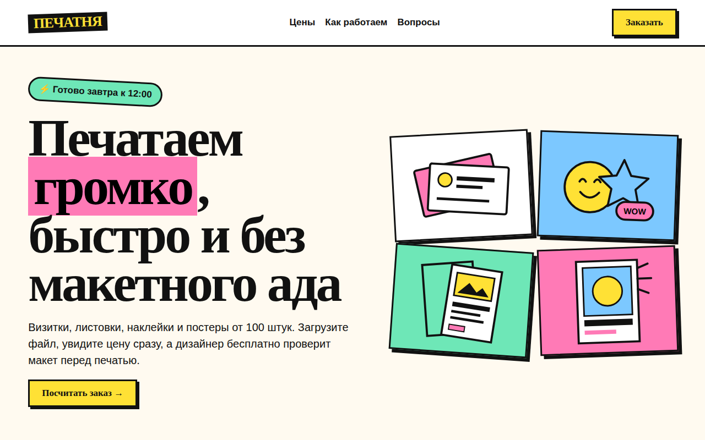

# ПЕЧАТНЯ: сайт типографии

Лендинг типографии в стиле необрутализма: толстые рамки, жёсткие тени, кислотные цвета и бегущая строка. Главная часть страницы это калькулятор тиража с мгновенной ценой и загрузкой макета.



## Возможности

**Калькулятор**
- Вид продукции: визитки, листовки A6, наклейки, постеры A3, у каждого своя SVG-иллюстрация
- Тираж: 100, 300, 500, 1000, 3000 штук
- Бумага: стандарт, матовая софт-тач, крафт, дизайнерская
- Печать с одной или двух сторон, срочность: 3 дня, завтра, сегодня
- Итоговая цена и цена за штуку пересчитываются при каждом выборе, минимальный заказ 490 ₽

**Заказ**
- Загрузка макета перетаскиванием или по клику, имя и размер файла после выбора
- Проверка размера файла: больше 50 МБ не принимается
- Проверка имени и телефона перед отправкой, подтверждение с составом и суммой

**Страница**
- Блоки «Как это работает» и FAQ на `<details>`
- Кнопки «нажимаются»: тень уходит, кнопка сдвигается

## Стек

HTML5, CSS3, JavaScript без библиотек, SVG, Drag and Drop API и `DataTransfer`, шрифт Rubik из Google Fonts.

## Как запустить

Сборка не нужна: откройте `index.html` в браузере.

Или через локальный сервер:

```bash
python -m http.server 8000
# затем http://localhost:8000
```

## Настройка

Все цены и коэффициенты лежат в начале скрипта в `index.html`:
- `PRODUCTS`: название, иллюстрация, базовая цена за штуку
- `QTY`: варианты тиража
- `PAPER`, `SIDES`, `SPEED`: название и множитель цены

## Структура проекта

```
index.html          # вёрстка, стили и скрипт
img/cards.svg       # иллюстрация визиток
img/flyers.svg      # иллюстрация листовок
img/stickers.svg    # иллюстрация наклеек
img/posters.svg     # иллюстрация постеров
```

## Как это устроено

- Цена за штуку равна базовой цене, умноженной на коэффициенты бумаги, сторон и срочности, и на скидку за тираж `(100 / n)^0,32`: настройка машины распределяется по тиражу, поэтому штука дешевеет с ростом тиража
- Итог округляется до 10 ₽ и не опускается ниже 490 ₽
- Все переключатели это обычные `radio` внутри формы, стилизованные через соседний `span`: работают с клавиатуры, фокус виден
- Файл, брошенный в зону загрузки, кладётся в скрытый `<input type="file">` через `DataTransfer`, так что форма видит его так же, как выбранный вручную
- `prefers-reduced-motion` останавливает бегущую строку и переходы кнопок, до 900 px калькулятор в одну колонку, меню скрывается

## Идеи для развития

- Предпросмотр PDF-макета и проверка разрешения картинок
- Произвольный тираж и формат
- Отправка заказа с файлом на сервер

## Лицензия

Концепт-сайт, реального бизнеса за ним нет.

MIT © 2026 whysafe. Telegram: [@yawhysafe](https://t.me/yawhysafe) · Сайт: [whysafe.ru](https://whysafe.ru)
